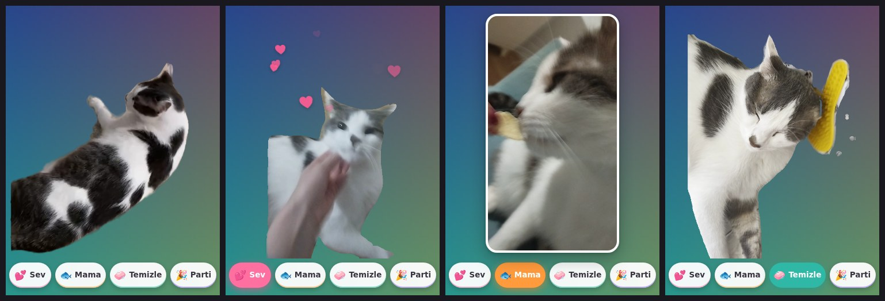
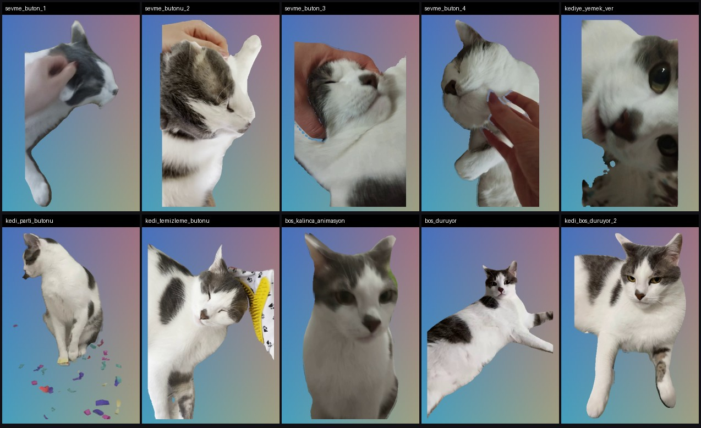

# My Dear Cat 🐾

A little desktop companion for Windows, made from real videos of a cat who was loved very much.
The cat lives in a corner of the screen with a transparent background. You can pet it, feed it,
brush it and throw it a party. When nobody is around, it just rests, the way it always did.



## Install

1. Download **Kedi-Kurulum.exe** from the [Releases](../../releases) page.
2. Double-click it → *İleri* (Next) → *Bitir* (Finish). No administrator rights needed.
3. The cat appears in the bottom-right corner and comes back every time the computer starts.

To uninstall: Windows Settings → Apps → **Kedi** → Uninstall.

> If Windows shows an "unknown publisher" warning, choose *More info → Run anyway*. The app just isn't code-signed.

The app's interface is in Turkish on purpose. It was made for a Turkish user.

## What it does

| | |
|---|---|
| **Sev** (Pet) | Plays one of four petting clips at random while hearts float up. Clicking the cat does the same. |
| **Mama** (Feed) | The cat eating, shown in a rounded frame. |
| **Temizle** (Clean) | The cat being brushed with a grooming glove. |
| **Parti** (Party) | The cat, plus confetti raining across the whole screen. |
| Idle | Stabilised loops; switches to a different pose at random every 25–50 s. |
| Mouse nearby | The cat turns and looks at you. |
| Dragging | Grab the cat and put it anywhere; it remembers the spot. |
| Click-through | Clicks on the transparent parts go straight through to the desktop. |

Right-click the cat icon next to the clock for: show/hide, size (4 steps), always on top, sound,
button visibility, start with Windows, reset position, open the videos folder, and quit.



## Videos

On start-up the app scans `videolar/` (videos). Each subfolder is a behaviour:

| Folder | When it plays |
|---|---|
| `bosta/` (idle) | Continuously, all loops in random order |
| `yaklasinca/` (on approach) | When the mouse comes close to the cat |
| `sevme/` (petting) | The Pet button and clicking the cat |
| `mama/`, `temizle/`, `parti/` | The Feed, Clean and Party buttons |
| `yedekler/` (spares) | Not used; alternatives (cut-out feeding clip, party clip with its own confetti) |

- `.webm` (VP9 with alpha) → a transparent cat. `.mp4`/`.mov` → a framed card.
- Dropping a new file into a folder adds it to the random pick. Buttons whose folder is empty are hidden.
- Sound in the action clips is embedded as Opus; the video streams were copied, never re-encoded.

## Development

```bash
npm install
npm start               # run the cat in development mode (reads videolar/ from the repo root)
npm run package         # dist/Kedi-win32-x64 (Windows x64 app)
npm run installer       # out/Kedi-Kurulum.exe (needs NSIS: apt install nsis)
```

Packaging also works on Linux and macOS; the Windows installer only needs `makensis`.

```
app/                 Electron app
  main.js            window, tray menu, dragging, proximity, confetti window, kedi:// protocol
  preload.js         the small API exposed to the renderer
  renderer/          index.html, app.js (player + behaviours), style.css, konfeti.html (confetti)
  test-scenario.js   automated screenshot test with KEDI_TEST=<dir> (never packaged)
videolar/            full-quality clips
build/               icon, NSIS script (installer.nsi), packaging scripts, Turkish user readme
video-processing/    the Python pipeline that cut the cat out of the original videos (below)
```

### Technical notes

- **Transparent window + click-through:** the window starts with `setIgnoreMouseEvents(true, {forward: true})`.
  On mouse move, the alpha of the pixel under the cursor is read from a canvas; over the cat the window becomes clickable.
- **`kedi://` protocol:** the page and the videos are served from the same origin, with Range support.
  This keeps the canvas untainted and makes seeking and looping reliable.
- **Dragging** runs in the main process by following the cursor; moving less than 5 px counts as a click.
- **Closing the window** (e.g. Alt+F4) quits the whole app cleanly.
- **Settings** live in `%APPDATA%\kedi\ayarlar.json`.
- Start-with-Windows entry: `HKCU\...\Run` → `com.hakan.kedi` (removed by the uninstaller).

## Video processing (`video-processing/`)

The scripts used to turn raw phone videos into transparent `.webm` clips. They're kept for reference and run on CPU.

- `detect.py`: YOLO11-seg masks for the cat (+ hands), HDR→SDR tone mapping
- `matting_base.py` / `matting.py`: per-frame masks, edge refinement, temporal median, colour decontamination (`decontaminate.py`), VP9 alpha encoding (CRF 15)
- `hand_tracking.py`, `glove_mask.py`, `confetti_mask.py`: SAM2 hand tracking, grooming glove and confetti masks
- `idle_loops.py`: idle loops with camera-shake stabilisation and ping-pong looping
- `repair_frames.py`, `despeckle.py`: find and fix flickering frames and stray mask specks
- `contact_sheet.py`: frame grids for visual checks

```bash
pip install -r video-processing/requirements.txt
SOURCE_DIR=/path/to/raw/videos/ python video-processing/matting.py sevme_buton_1
```

---

Made with love by Hakan. 💕
